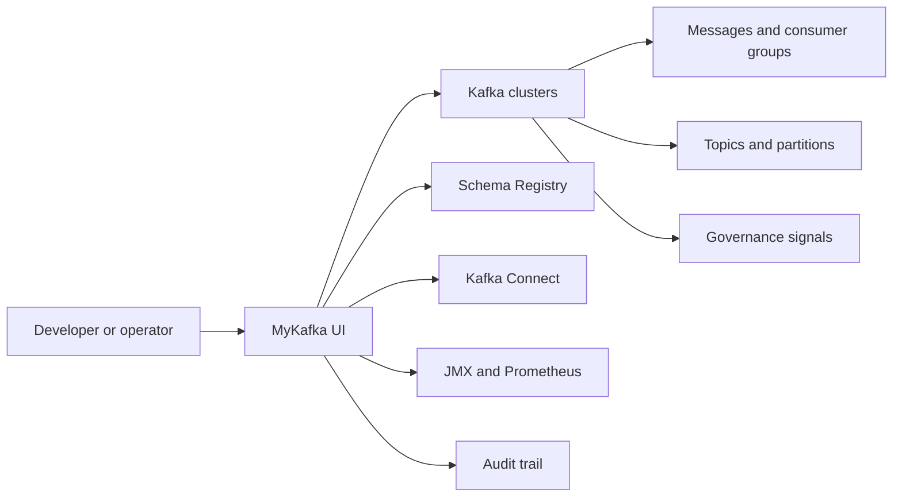
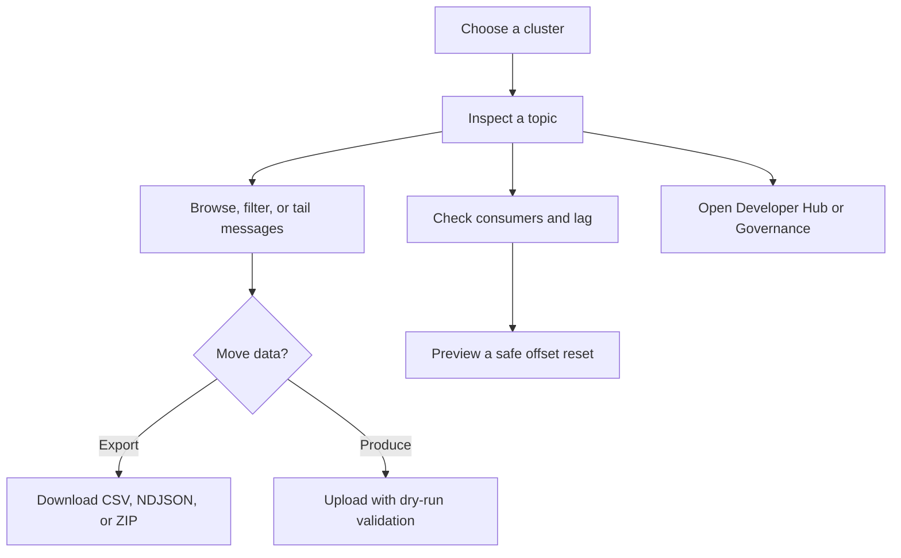
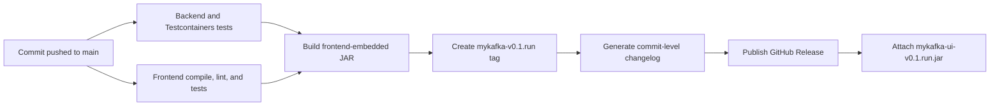
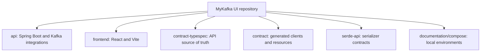

<div align="center">

# MyKafka UI

**Kafka operations with a clear view.**

A personal, independently maintained Kafka control surface for developers and operators who need to inspect, move, govern, and troubleshoot Kafka data without losing the thread.

[](https://github.com/joelpjoji-mns/Mykafka-Ui/actions/workflows/branch-ci.yml)
[](https://github.com/joelpjoji-mns/Mykafka-Ui/releases)
[](LICENSE)

[Release Downloads](https://github.com/joelpjoji-mns/Mykafka-Ui/releases) · [Changelog](CHANGELOG.md) · [Workflow Runs](https://github.com/joelpjoji-mns/Mykafka-Ui/actions) · [Repository](https://github.com/joelpjoji-mns/Mykafka-Ui)

</div>

---

## What MyKafka UI Is

MyKafka UI keeps the mature Kafka administration foundation from upstream Kafbat UI and adds operational workflows that are useful during real development and incident response: safe consumer resets, history-plus-live message tailing, topic data transfer, audit exploration, governance advice, cluster operations, and developer signals.

The MyKafka UI mark is an original bat-inspired fork mark. It is not the official Batman or DC logo.



## Built For The Work In Front Of You

| Surface | What it gives you |
| --- | --- |
| **Messages** | Serde-aware browsing, multiple text refinements, smart filters, timestamp windows, offset seeks, resizable columns, key/header/value previews, and live arrivals at the top of the table. |
| **Live tail** | A bounded historical snapshot first, then a gap-free stream from checkpointed Kafka end offsets. New records arrive above the existing view. |
| **Consumer safety** | Offset reset impact previews for earliest, latest, timestamp, and explicit offsets. Active groups can wait indefinitely for inactivity, with cancellation. Consumers are never paused or removed by offset reset. |
| **Topic transfer** | Download CSV, NDJSON, or ZIP exports with partition/filter/serde controls. Upload one file, many files, or ZIP archives with dry-run previews and routing strategies. |
| **Developer Hub** | Topic health, topology, storage, configuration, traffic, consumer, and integration signals with concrete next actions. |
| **Operations Center** | Cluster-wide health, broker state, topic pressure, consumer lag, and integration status in one place. |
| **Governance and audit** | Topic compliance recommendations, an audit explorer with cursor pagination, and cross-topic record search over bounded recent samples. |
| **Visual modes** | Auto, Light, Dark, Midnight, Harbor, Ember, AMOLED, and Glass. Glass uses material navigation and transient controls while keeping data tables stable and readable. |



## Release-Ready By Default

Every successful push to `main` follows the same release lane. Pull requests receive checks and a packaged JAR, but only green `main` commits create a public release.



### Release Contract

- A green `main` run creates `mykafka-v0.1.<workflow-run>`.
- The application version and GitHub release tag are identical, so the UI can accurately identify the latest release.
- The release asset is named `mykafka-ui-v0.1.<workflow-run>.jar`.
- Release notes include the exact non-merge commits since the previous `mykafka-v*` tag, falling back to the last compatible `custom-v*` release for the first MyKafka UI release.
- Workflow artifacts are retained for 30 days in addition to the GitHub Release asset.
- The manual **MyKafka UI: Build Release JAR** workflow remains available for an artifact-only build or an explicitly named release.

## Download And Run

1. Open [Releases](https://github.com/joelpjoji-mns/Mykafka-Ui/releases).
2. Download the latest `mykafka-ui-v*.jar` asset.
3. Run it with your configuration file.

```bash
java -jar mykafka-ui-v0.1.<run>.jar \
  --spring.config.additional-location=path/to/mykafka-ui-config.yaml
```

The packaged application exposes health at `/actuator/health` and build information at `/actuator/info`.

### Search, Sorting And Export Limits

The **Consumers** list supports comma-separated searches in its existing search
bar, for example `abcd, uhdg`. Results are the union of searching each term
separately, with no duplicate groups. Spaces around terms and empty entries are
ignored; a query containing only commas/spaces matches nothing. Clearing the search
shows all groups again. Existing single-term matching, including the configured
full-text search mode, is preserved. Sorting and pagination apply to the combined
results, and **Export CSV** uses the same multi-search.

The topic tabs include **Messages**, **Search**, then **Download**. Messages keeps
its browsing controls without the advanced search toolbar. Search opens with a
large search bar and example terms; no messages are fetched or displayed until
you enter a nonempty search. Searching starts automatically after a 300 ms typing
pause; clearing the input hides the results. Search text and matching options are
saved per cluster/topic and restored when returning to Search. Matches are
highlighted in message previews and expanded values. Searches start from Oldest
by default. Advanced
partition, time, offset and serde controls are collapsed below active searches.
Search supports up to **500 distinct comma-separated terms** such as `1,2,3,4`.
The fixed-width search field shows the term count and rejects searches above
this limit without silently dropping terms. **ANY (OR)** returns messages matching any
individual term, without duplicate rows; **ALL (AND)** requires all terms. Searches
are case-sensitive substring matches. Scope can be key/value/headers or headers only
(both header names and values). Partition, offset, time-window, serde and smart-filter
controls remain available. Smart filters are combined with text searches using AND.
Live mode searches a bounded recent snapshot plus new arrivals; use Oldest or a time/
offset window when searching historical records.

The message-limit field (1,000 by default, up to 5,000 in the UI) controls the number of matching rows
loaded, not the number of search terms. Key/Value Serde selectors control how
Kafka bytes are decoded; choose String or JSON for text searches, rather than a
binary/numeric decoder such as Hex or UInt64.

The bundled server accepts request lines up to 64 KB to accommodate large search
lists. If a reverse proxy is used, its URL/request-line limit must also allow
these requests. Very long individual terms remain subject to request-size limits.

Click Message ID, Offset, Partition, Timestamp, Size, Key, Headers or Value headings
to toggle ascending/descending sorting across the whole topic. Default Kafka ordering
is preserved until a heading is selected. Size includes serialized key, value and
headers. Text columns sort their full values, not just the displayed preview.

Every heading click scans every retained record across all partitions and
returns the top/bottom page of matches; there is no page-only sorting selector. The scan
applies text and smart filters and the selected decoders, but ignores partition,
offset and time restrictions. It captures partition end offsets at scan start;
new arrivals require another scan. Progress and **Cancel topic scan** are shown
while scanning. No partial ranking is displayed. Kafka has no sort indexes, so
large topics can take time; the server retains only the requested top results,
not the entire topic. Pagination is disabled for this ranked result set.

While an automatic search updates, the results layout and Advanced filters stay
mounted with a loading indicator. Previous rows are hidden immediately, obsolete
streams are cancelled, and only rows for the current query can be displayed.

Search exports matching results as NDJSON beyond the displayed page, up to the chosen
export limit. Download also supports CSV and ZIP; import Message View filters to
preserve the applied search scope and matching mode. Export defaults to 5,000 messages
(independent of the 1,000-message browsing default). Configure larger limits in YAML:

```yaml
kafka:
  polling:
    max-page-size: 25000
    default-download-limit: 10000
    default-page-size: 1000
```

`max-page-size` caps server-side browsing and exports; the Download and Search export
controls obtain their maximum from the server. `default-download-limit` defaults to
5,000 and is capped by `max-page-size`. Large exports consume memory because the
result is assembled before download. These configuration changes require a restart.

Offset reset with **Wait for an active consumer group to become inactive** has no
fixed wait timeout. The pending dialog can be cancelled, and leaving the page also
cancels its request. Waiting never pauses or removes consumers. Cancellation cannot
undo a reset already applied if the group became inactive concurrently. Reverse
proxies must permit long-running requests for indefinite waiting.

Topic-based application-consumer pause/resume and cooperative active-group offset
reset have been removed. Consumer details no longer probe or create control topics.
Kafka Admin APIs cannot remotely pause an arbitrary application consumer. A future
no-control-topic implementation would require authenticated application management
endpoints on every consumer instance, with poll-thread pause/resume, in-flight work
draining, member verification, and an existing durable store if pause must survive
restarts. No such application endpoints are configured by this UI. Kafka Connect
connector pause/resume remains available through its existing REST API.

Theme-aware base text keeps Search and offset-reset instructions readable in dark,
Midnight and AMOLED themes. Offset-reset partition pickers and the timezone chooser
also use the active theme's control surfaces.

## Local Development

### Prerequisites

| Tool | Version |
| --- | --- |
| Java | 25 |
| Node.js | 22.13.0 |
| pnpm | 10.26.1 |
| Docker | Required for integration and compose environments |

### Build A Local JAR

```bash
./gradlew :api:bootJar --no-daemon \
  -Pinclude-frontend=true \
  -Pversion=mykafka-local

java -jar api/build/libs/api-mykafka-local.jar \
  --spring.config.additional-location=path/to/mykafka-ui-config.yaml
```

### Validate The Stack

```bash
# Backend, including Kafka/Testcontainers coverage
./gradlew :api:test

# Frontend contract generation, typecheck, lint, and tests
cd frontend
pnpm install --frozen-lockfile
pnpm compile
pnpm eslint --quiet --ext .tsx,.ts src/
pnpm test:CI
```

Use the managed Node 22 development server so the local checker matches CI:

```bash
./gradlew :frontend:devFrontend
```

Set `VITE_DEV_PROXY` in `frontend/.env.local` when the frontend should proxy requests to a separately running API.

## Configuration At A Glance

| Need | Setting |
| --- | --- |
| Dynamic cluster configuration | `DYNAMIC_CONFIG_ENABLED=true` |
| Swagger UI | Set `SWAGGER_UI_ENABLED=true`, then open `/swagger-ui/index.html` |
| Dynamic config path | `/etc/kafkaui/dynamic_config.yaml` |
| Health endpoints | `/actuator/health` and `/actuator/info` |
| Compose examples | [documentation/compose](documentation/compose) |

MyKafka UI supports the existing Kafka, Schema Registry, Connect, KSQL, JMX, Prometheus, authentication, RBAC, and masking configuration model from upstream.

## Changelog Philosophy

The repository keeps a human-readable policy in [CHANGELOG.md](CHANGELOG.md), while each release contains the authoritative commit-level changelog generated from Git history. That gives every JAR a concrete answer to: *what changed since the last release?*

## Project Map



## Attribution

MyKafka UI is derived from [Kafbat UI](https://github.com/kafbat/kafka-ui) and remains distributed under the [Apache License 2.0](LICENSE). This fork is independently maintained and is not affiliated with, endorsed by, or released by the upstream Kafbat organization.
